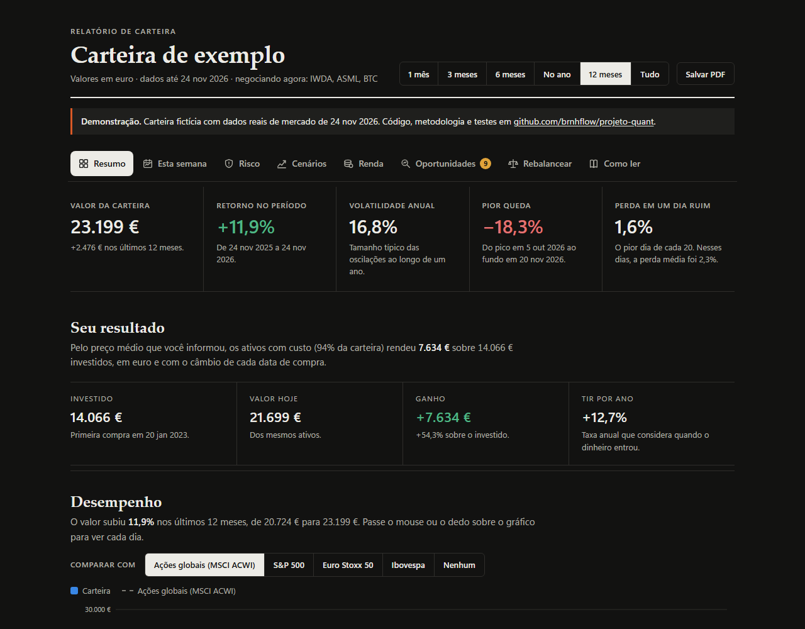
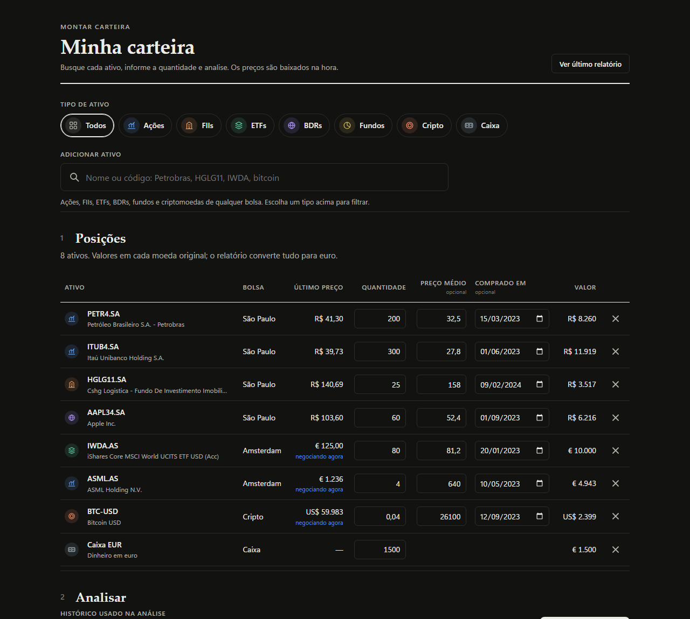
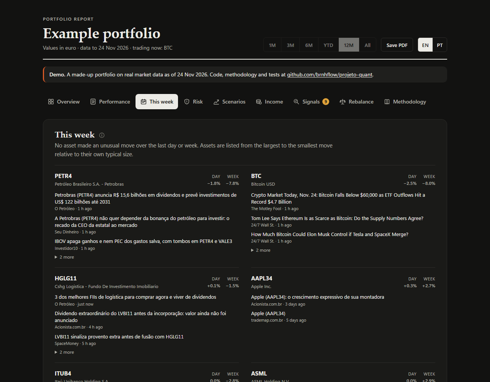
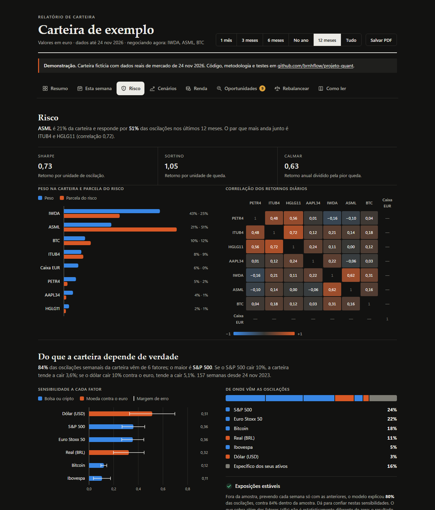
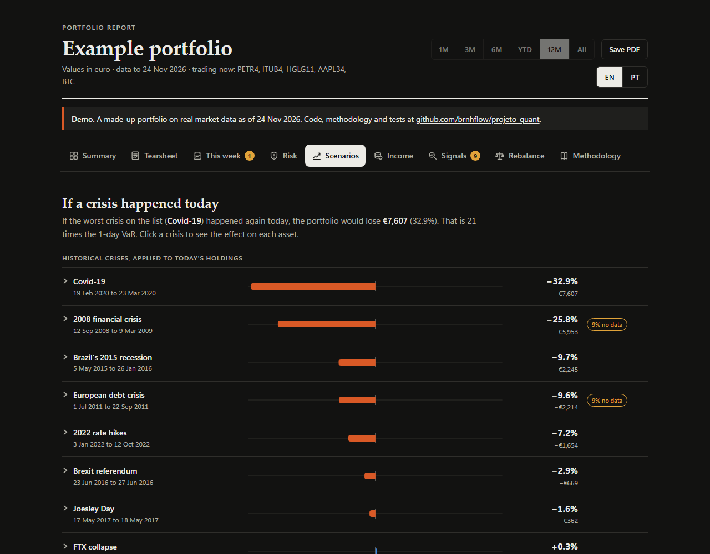
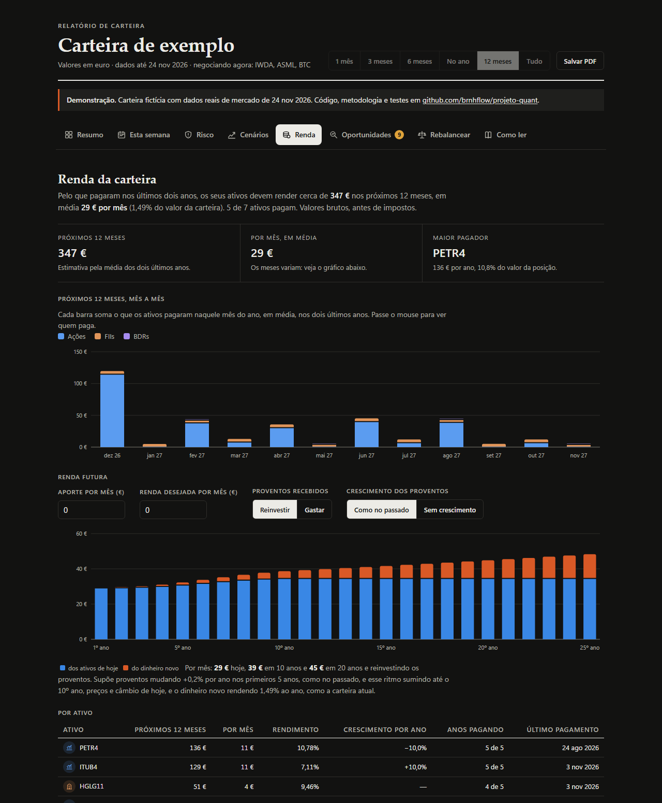
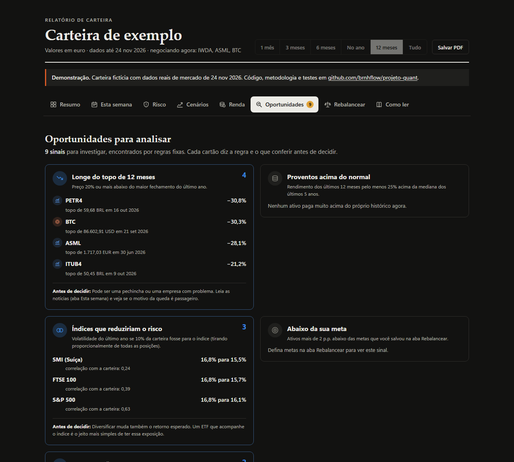
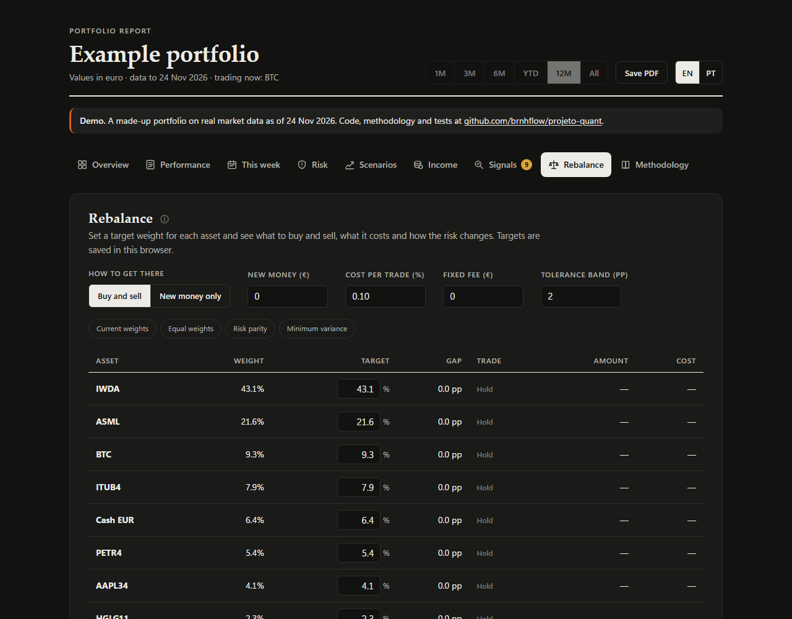
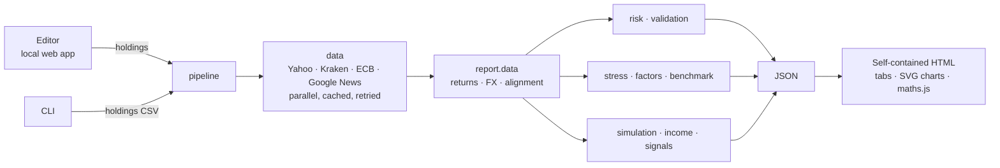

# projeto-quant

**A portfolio risk lab that checks its own numbers.** It pulls live market data for stocks,
real-estate funds, ETFs, BDRs and crypto across B3, Europe and the US, and analyses the
portfolio in euro: risk, crisis replays, factor exposures, Monte Carlo, dividend income and
rebalancing. Every model comes with the test that says whether to trust it.

[](https://github.com/brnhflow/projeto-quant/actions/workflows/ci.yml)


[](LICENSE)

**[Live demo](https://brnhflow.github.io/projeto-quant/)** · [Methodology](docs/METHODOLOGY.md) · [Roadmap](docs/ROADMAP.md) · [Changelog](CHANGELOG.md)



## Why

Most portfolio dashboards show numbers. Few say how far those numbers can be trusted. Some
estimates look exactly as confident on screen as good ones but are not:

- a 95% VaR that is breached on 9% of days;
- a beta estimated from 40 weeks of a volatile stock;
- a Monte Carlo fan that never contained what actually happened.

This project treats every estimate as a claim to be tested:

- the VaR is replayed day by day and judged with the Kupiec, Christoffersen and Basel tests;
- factor exposures are refitted walk-forward and scored out of sample;
- the Monte Carlo ranges are checked month by month against what actually happened;
- headline figures come with bootstrap confidence intervals.

When a model fails its test, the report says so in plain language.

## What it does

| | |
|---|---|
|  | **Build the portfolio.** Search any listed instrument by name or ticker; every match is returned, not just the top seven. Pick its type from drawn icons and type the quantity. Optionally add the average price paid and the first purchase date, and the report shows the gain on the money actually invested and its annual money-weighted return (XIRR). Cash in 15 currencies counts too. |
|  | **This week.** Assets whose last day or week moved more than 2.5 standard deviations of their own history are flagged, next to the headlines that explain the move. |
|  | **Risk.** Volatility, drawdown, historical VaR and ES, Sharpe, Sortino and Calmar. How much each asset adds to total risk (Euler decomposition) and the correlation matrix. A factor model of what the portfolio really depends on, with error bands and an out-of-sample check. |
|  | **Scenarios.** Eight real crises applied to today's positions: 2008, euro debt, Brazil 2015, Brexit, Joesley Day, Covid, 2022 rates and FTX. Assets that did not exist yet are estimated from their closest index, with a Vasicek-shrunk beta. Sliders build any custom scenario, and a 2,000-path block-bootstrap fan shows 1 to 5 years ahead. |
|  | **Income.** Dividends expected month by month for the next year. Income over 25 years, with monthly contributions, reinvestment and a monthly goal. |
|  | **Opportunities.** Fixed, stated rules that flag things worth investigating: far below the 52-week high, yield above its own history, indices that would lower volatility, positions below target, concentration. These are signals, never advice. |
|  | **Rebalance.** Units to buy and sell to reach target weights: current, equal, risk parity, long-only minimum variance or your own. Includes costs, tolerance bands, whole-unit rounding and an "only add new money" mode. Every plan pays for itself. |

The report is a single self-contained HTML file:

- no server and no network once written;
- light and dark themes;
- works on a phone;
- prints to PDF.

## How the numbers are checked

| Estimate | Test | Reference |
|---|---|---|
| Value at Risk | Day-by-day backtest using only past data. Checks the breach frequency, whether breaches cluster, and the Basel traffic-light zone | Kupiec (1995), Christoffersen (1998), Basel Committee (1996) |
| Return, volatility, Sharpe, VaR | 90% intervals from 2,000 stationary-bootstrap resamples | Politis and Romano (1994) |
| Factor exposures | Walk-forward out-of-sample R² compared with in-sample R²; t-statistics | |
| Monte Carlo ranges | Monthly check of the 90% range, with a two-sided binomial test | |
| Proxy betas for missing history | Shrinkage towards 1 according to estimation error | Vasicek (1973) |
| Covariance for optimisation | Shrinkage to a scaled identity; matches scikit-learn | Ledoit and Wolf (2004) |
| Risk parity | Gives inverse-volatility weights for independent assets, and equal risk contributions with correlation | Griveau-Billion, Richard and Roncalli (2013) |
| Portfolio value | Independent pandas recomputation on a live 12-asset, 6-currency portfolio | |

Unit tests compare against answers known in advance:

- chi-squared critical values;
- Jorion's acceptance region for 255 days;
- the Basel 250-day table;
- the lognormal distribution;
- hand calculations.

The JavaScript maths in the page is tested with Node, and CI syntax-checks the assembled page
script. Formulas and details are in [docs/METHODOLOGY.md](docs/METHODOLOGY.md).

## Quick start

Requires [uv](https://docs.astral.sh/uv/), which installs the right Python by itself. Node.js
is optional; it is only needed for the JavaScript tests.

```bash
git clone https://github.com/brnhflow/projeto-quant && cd projeto-quant
uv sync
uv run python -m quant app            # portfolio editor at http://127.0.0.1:8750
```

Then:

1. Search the assets and type the quantities.
2. Press **Analisar carteira**. Prices, exchange rates, dividends and headlines are downloaded at that moment and the report opens.

The portfolio is saved to `data/private/holdings.csv`, which git ignores, and is filled in
again next time.

```bash
uv run python -m quant report --holdings data/holdings.example.csv   # same from the CLI
uv run python scripts/build_site.py                                  # rebuild the live demo
uv run python -m pytest                                              # 320+ tests
uv run python -m pyright && uv run ruff check .                      # strict types, lint
```

## Architecture



```
src/quant/
├── data/          market data: sources, HTTP with retries, cache with fallback, news
├── returns.py     returns and buy-and-hold portfolio value
├── fx.py          currency conversion
├── align.py       calendar alignment without look-ahead
├── risk.py        volatility, drawdown, VaR/ES, risk contributions, Ledoit-Wolf, ratios
├── validation.py  VaR backtests, stationary bootstrap
├── stress.py      historical crises, proxy betas
├── factors.py     factor regression, walk-forward test
├── benchmark.py   beta, alpha, tracking error, information ratio, capture
├── simulation.py  Monte Carlo and its calibration
├── income.py      dividend calendar and growth
├── signals.py     rule-based opportunity signals
├── pipeline.py    download, compute, render (shared by the CLI and the app)
├── report/        report data, template, CSS, page scripts (js/) and tested maths.js
└── app/           local web app: stdlib HTTP server and the portfolio editor
```

## Design decisions

- **Analysis only, no trading.** It reads public data and produces analysis. There is no broker
  connection and no order is ever placed.
- **No look-ahead.** Anything dated *t* uses only data up to *t*. Tests change future data and
  assert that past results do not move.
- **Adjusted prices are re-downloaded in full.** Dividend adjustments rewrite past prices, so
  appending new data would mix old and new adjustments. Downloads run four at a time and fall
  back to a local cache when a source fails; the report flags any series that came from the
  cache.
- **Few dependencies.** Only pandas and numpy. HTTP, the web server and the RSS parser come from
  the standard library, charts are hand-written SVG, and the page loads nothing from the
  network.
- **The local app is hardened like a public one.** It:
  - binds to 127.0.0.1;
  - checks the `Host` header against DNS rebinding;
  - requires a custom header on every API call, so other websites cannot call it;
  - accepts JSON only;
  - validates every input and escapes every external string.
- **Cautious defaults.**
  - The Monte Carlo removes the past trend by default.
  - Projected dividend growth fades out over time.
  - Benchmark price indices are labelled "without dividends".

## Data sources

| Data | Source | Notes |
|---|---|---|
| Prices, dividends, indices | Yahoo Finance chart API | Unofficial API; adjusted for splits and dividends; pence converted to pounds |
| Search | Yahoo search and lookup APIs | Lookup lists every match, paged |
| Crypto (alternative) | Kraken public API | Official, no key, at most 720 days |
| Exchange rates | ECB reference rates via [Frankfurter](https://frankfurter.dev) | One rate per TARGET business day |
| Headlines | Google News RSS | B3 stocks searched by ticker in Portuguese, others by name in English |

The interface is in Portuguese; code, tests and documentation are in English.

## Limitations

- Apart from the gain on money invested, holdings are treated as held for the whole history,
  because there is no full transaction log yet. Past figures describe today's portfolio, not
  past decisions.
- Free data has gaps, survivorship bias and occasional adjustment errors. Yahoo's API is
  unofficial and may change.
- Models are simplifications. Nothing here is financial advice.

## License

MIT. See [LICENSE](LICENSE).
