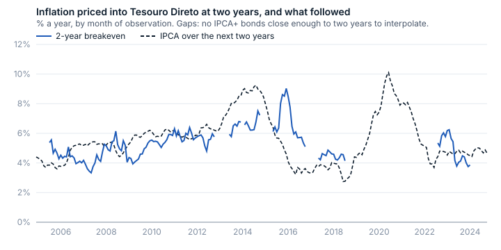

# Does the inflation priced into Tesouro Direto predict Brazil's IPCA? 2005 to 2024

*Research note. Reproduce with `uv run python research/breakeven.py`; raw results in
[breakeven-results.csv](breakeven-results.csv). Tesouro Direto rates to 19 November 2026, IPCA
to October 2026; the last forecast that can be scored is from January 2024.*

## Summary

Brazil's Treasury sells two kinds of bond to the public at similar maturities: fixed-rate
(Prefixado) and inflation-linked (IPCA+). The gap between their rates is the inflation the market
prices in, the breakeven, which the project's report shows on the Fixed income tab. This note
asks whether that number forecast the inflation that followed, and how large the inflation risk
premium inside it is.

- **The breakeven carries real but limited information.** Built from bonds close to the horizon,
  it explains 14% to 16% of the variation in realised IPCA at one, two and three years, with
  slopes of 0.5 to 0.7 against the 1 of a perfect forecast. An unbiased forecast is not rejected
  once the three horizons are corrected for.
- **No premium over realised inflation can be detected.** On average the breakeven came in 0.07
  to 0.20 points a year *below* realised inflation, with 95% intervals of roughly ±0.55 to ±0.7
  points that include zero.
- **Against the Central Bank's Focus survey, the breakeven sat 0.24 points higher** (95%
  interval +0.02 to +0.46) and forecast slightly better at one year (root mean squared error
  1.37 against 1.50 points, not significant). The gap is the sign and rough size a premium
  predicts, and it is the only premium estimate here that clears 5%, on 51 months.
- **The answer depends on how the curve is built.** With the report's looser rule, which lets the
  curve be interpolated across gaps of four years from bonds a few months from maturity, the
  two- and three-year breakevens show almost no relation to what followed. Much of that
  difference comes from forecasts made in 2018 to 2020, when no IPCA+ bonds near two years were
  on sale; the cleaner two-year sample has no forecasts from 2019 to 2021 at all.

The sample has at most about eighteen windows that do not overlap, and six at three years. The
honest conclusion is that this history cannot pin the premium down, not that it is zero.

## Question and design

The breakeven is (1 + nominal rate) / (1 + real rate) − 1 at the same maturity. If investors
demand extra return for bearing inflation risk in fixed-rate bonds, it sits above expected
inflation, and on average above the inflation that follows. If the market's forecast is also
efficient, a regression of realised inflation on the breakeven should have an intercept of zero
and a slope of one.

| | |
|---|---|
| Rates | Tesouro Transparente, daily buy rates of every Tesouro Direto bond, parsed by `quant.data.rates.parse_tesouro`. The file starts on 31 December 2004. |
| Breakeven | On the last trading day of each month, the Prefixado curve (zero-coupon and semi-annual coupon bonds) and the IPCA+ curve (both kinds) are interpolated linearly at 1, 2 and 3 years (`quant.fixed_income.breakeven`). Bonds with half a year or less to maturity are left out, and a curve reaches a horizon only if the two bonds around it are at most two years apart. Months that fail are left out rather than extrapolated. |
| Outcome | IPCA, Banco Central do Brasil SGS series 433, compounded over the 12, 24 or 36 months after the observation month and annualised. |
| Survey | Focus median forecast of IPCA over the next 12 months, non-smoothed series, from the Central Bank's official Olinda API, read on or before the same day. |
| Inference | Newey-West (1987) errors with 12h − 1 lags, because consecutive h-year windows share all but one month; Holm (1979) correction across the three horizons. |

**One change was made after seeing results.** The first run used the report's rule (any bond
with more than three months left, any gap between bonds). Its chart showed a negative two-year
breakeven in April 2020, interpolated between an IPCA+ bond 3.5 months from maturity quoting a
real rate of 6.07% and the next one 4.3 years out. A bond that close to maturity earns mostly
inflation that is already published or projected, so its quoted real rate is noise. The two
limits above were added for that reason, and the first rule's results are reported in full as a
robustness check (section 4).

Three tests:

1. **Mincer and Zarnowitz (1969) regression** of realised inflation on the breakeven, with a
   joint Wald test of intercept 0 and slope 1.
2. **Premium**: the mean of breakeven minus realised, with a Newey-West 95% interval.
3. **Survey**: the same regression for Focus, a Diebold and Mariano (1995) test of the squared
   errors of the two forecasts on the months both exist, and the mean gap between the 1-year
   breakeven and Focus.

## Results

### 1. Some information, at every horizon

| Horizon | Months | Windows without overlap | Intercept | Slope (se) | R² | Wald p | Holm p |
|---|---|---|---|---|---|---|---|
| 1 year | 51 | ~18 | +1.84 | 0.66 (0.30) | 0.16 | 0.38 | 0.38 |
| 2 years | 155 | ~9 | +2.61 | 0.52 (0.28) | 0.16 | 0.067 | 0.13 |
| 3 years | 148 | ~6 | +2.37 | 0.59 (0.27) | 0.14 | 0.044 | 0.13 |

Short IPCA+ bonds were often not on offer, so the one-year sample is the smallest: 51 months
between August 2005 and January 2024. The count of windows without overlap is the span of each
sample divided by the horizon, and is the better guide to how much evidence there is.

The slopes are positive and between one and two standard errors below one. A slope below one
with a positive intercept is what a forecast looks like when it moves in the right direction but
by too much; it is also what a time-varying premium would produce. With this many independent
windows the two cannot be told apart.

### 2. The premium cannot be told from zero

| Horizon | Mean breakeven | Mean realised | Breakeven − realised | 95% interval |
|---|---|---|---|---|
| 1 year | 4.90% | 5.10% | −0.20 pp | −0.75 to +0.35 |
| 2 years | 5.30% | 5.37% | −0.07 pp | −0.74 to +0.61 |
| 3 years | 5.38% | 5.55% | −0.17 pp | −0.86 to +0.52 |

A premium predicts a positive gap; the estimates are slightly negative and their intervals are
wide. By year of observation, the two-year breakeven was 2.3 points too low in 2014, ahead of
the 10.7% inflation of 2015, and 2.6 points too high in 2016, when it still priced that episode
as inflation fell. Single episodes of this size move the mean by more than any plausible premium.

### 3. The survey: a premium-sized gap

| One year ahead | Months | Mean error | RMSE | Slope (se) | Wald p |
|---|---|---|---|---|---|
| Focus, every month with an outcome | 251 | −0.69 pp | | 0.56 (0.43) | 0.15 |
| Breakeven, months both exist | 51 | −0.20 pp | 1.37 | | |
| Focus, months both exist | 51 | −0.44 pp | 1.50 | | |

Both forecasts underpredicted inflation on average, which points to surprises rather than to a
premium. On the common months the breakeven's squared errors were lower, but not significantly
(Diebold-Mariano t = −1.73, p = 0.083).

The gap between the one-year breakeven and Focus does not depend on how inflation turned out,
so it is a cleaner estimate of the premium. It averaged **+0.24 points** (standard error 0.11,
95% interval +0.02 to +0.46). That is the sign and the order of magnitude a premium predicts,
but it rests on 51 scattered months, and part of it may be liquidity or the difference between
the survey's horizon and the bonds'.

### 4. Robustness: the report's rule gives a different answer

| Horizon, report's rule | Months | Slope (se) | R² | Wald p | Breakeven − realised (se) |
|---|---|---|---|---|---|
| 1 year | 103 | 0.45 (0.29) | 0.16 | 0.094 | −0.27 pp (0.35) |
| 2 years | 200 | 0.18 (0.30) | 0.02 | 0.006 | −0.20 pp (0.36) |
| 3 years | 206 | 0.03 (0.26) | 0.00 | <0.001 | −0.26 pp (0.37) |

The looser rule keeps more months (103 against 51 at one year, about 50 more at two and three),
and at two and three years the relation disappears. The extra months are spread over the whole
sample but cluster in 2018 to 2020, when the shortest IPCA+ bonds on sale were either a few
months from maturity or about four years out, so a two-year value is an interpolation across
that gap. The cleaner two-year sample has no forecasts from 2019 to 2021 at all, and those are
the forecasts whose outcome was the 2021-22 inflation surge: the stricter rule avoids a
measurement problem and, with it, one of the two largest surprises of the period.

As an exploratory check, chosen after seeing this table, dropping the forecasts made in 2018 to
2020 from the looser sample brings part of the relation back: slopes of 0.80, 0.43 and 0.30 and
R² of 0.31, 0.11 and 0.05 at one, two and three years. So those three years explain much of the
difference, but not all of it. The premium estimates barely change: under either rule it is a
small negative number with an interval of about ±0.7 points.

## Caveats

- **Sensitivity to construction.** Section 4 shows that the forecasting result depends on how
  the curve is built and on forecasts made in 2018-2020. A fitted zero-coupon curve (for example
  Nelson-Siegel) on the wholesale market's bonds would be the next step; this note does not do
  it.
- **Retail rates.** Tesouro Direto quotes the rate at which individuals buy, slightly below the
  wholesale market's. The spread applies to both kinds of bond, so it should mostly cancel in the
  breakeven, but not exactly.
- **Coupon bonds mixed with zero-coupon bonds.** Each curve averages the yields of both kinds
  at similar maturities; yields to maturity of coupon bonds are not spot rates.
- **Indexation lag.** IPCA+ bonds are indexed with a lag of about half a month and a projection in
  between. The outcome window starts in the month after observation, which matches the bond's
  accrual only approximately.
- **Not only a risk premium.** Breakeven minus expected inflation also contains liquidity
  differences between the two kinds of bond and a convexity term; this note does not separate
  them.
- **Gaps in the sample.** The months used are not contiguous, and Newey-West errors treat
  neighbouring observations in the sample as neighbours in time. With six to eighteen
  independent windows, every interval here should be read as approximate.

## What changes in the project

The Fixed income tab used to call the breakeven "an upper estimate" of expected inflation
because it contains a premium. That is right in theory, but over 2005-2024 the premium against
realised inflation could not be measured and the gap to the survey was about a quarter of a
point. The tab now says that, calls the breakeven a rough forecast, and links to this note.

## References

- Diebold, F., Mariano, R. (1995). Comparing predictive accuracy. *Journal of Business and
  Economic Statistics*, 13(3), 253-263.
- Holm, S. (1979). A simple sequentially rejective multiple test procedure. *Scandinavian Journal
  of Statistics*, 6(2), 65-70.
- Mincer, J., Zarnowitz, V. (1969). The evaluation of economic forecasts. In J. Mincer (ed.),
  *Economic Forecasts and Expectations*, 3-46. NBER.
- Newey, W., West, K. (1987). A simple, positive semi-definite, heteroskedasticity and
  autocorrelation consistent covariance matrix. *Econometrica*, 55(3), 703-708.
