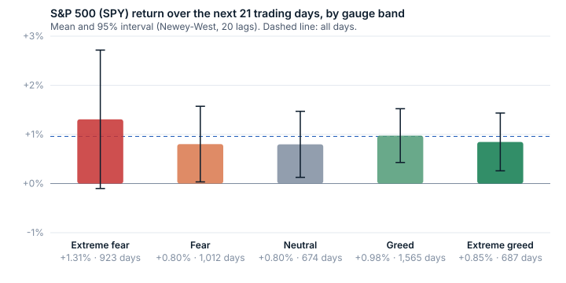

# Does a fear and greed gauge predict the S&P 500? A test, 2007 to 2026

*Research note. Reproduce with `uv run python research/fear_greed.py`; raw results in
[fear-greed-results.csv](fear-greed-results.csv). Data to 24 November 2026.*

## Summary

Market commentary often reads sentiment gauges as contrarian signals: buy when the crowd is
fearful, be careful when it is greedy. This note tests that reading on the five-part gauge the
project's report shows, rebuilt from public prices over 4,882 trading days.

Over the full sample the gauge has **no detectable relation** with the S&P 500's return over the
next week, month or quarter. The slopes have the contrarian sign but t-statistics below 0.5 in
absolute value, and the gauge explains less than 0.1% of the variation in forward returns.

Leaving out the 2008-09 crisis, the contrarian sign strengthens at three months (t = −2.38),
but that subsample was chosen after looking at the data, the evidence does not survive a
correction for the three horizons tested at 5% (Holm p = 0.051), and the gauge still explains
about 2% of the variation.

The practical test fails clearly. The best of ten simple timing rules, chosen on 2007-2017,
returned 13.1% a year from 2018 against 15.6% for holding the index, at the same volatility.
The report keeps the gauge as a description of current mood and now says, with this note as
the reference, that it is not a timing signal.

## Question and design

If extreme fear marks good entry points, the gauge should be negatively related to what the
index does next. The design was fixed before the results were seen.

| | |
|---|---|
| Gauge | `quant.sentiment.gauge_series`: the average of five parts (S&P 500 momentum and strength, VIX against its average, stocks against Treasuries, high yield against Treasuries), each the percentile of today's value among the previous two years. A day's value uses no later data. |
| Data | Daily, Yahoo Finance: ^GSPC, ^VIX, HYG, IEF for the gauge; SPY total return (dividends included) as the outcome |
| Sample | 2 July 2007, the first day all parts exist, to 24 November 2026: 4,882 days |
| Outcome | SPY return over the next 5, 21 and 63 trading days from the close the gauge is read on |
| Inference | Newey-West (1987) standard errors with h − 1 lags, because consecutive h-day windows overlap; Holm (1979) correction within each family of tests |

Three tests:

1. **Predictive regression** of the forward return on the gauge, slope per 10 points, at three
   horizons.
2. **Bands**: the forward 21-day return when the gauge is in each band the page uses (below 25
   extreme fear, 25-45 fear, 45-55 neutral, 55-75 greed, above 75 extreme greed), against all
   other days.
3. **Out of sample rules**. (A) hold SPY except when the gauge is above a threshold of 70, 75,
   80, 85 or 90; (B) hold half the position, and all of it when the gauge is below 10, 15, 20,
   25 or 30. The signal is read at the close and applied to the next day, with 5 basis points per
   unit traded and no interest on cash. The rule with the best Sharpe ratio from July 2007 to
   December 2017 is then judged from January 2018, with its probabilistic and deflated Sharpe
   ratio (Bailey and López de Prado, 2014) for having picked the best of ten.

## Results

### 1. No relation over the full sample

| Horizon | Slope per 10 points | t (Newey-West) | Holm p | R² |
|---|---|---|---|---|
| 5 days | −0.014 pp | −0.40 | 1.00 | 0.02% |
| 21 days | −0.051 pp | −0.46 | 1.00 | 0.06% |
| 63 days | −0.002 pp | −0.01 | 1.00 | 0.00% |

A slope of −0.05 points per 10 gauge points means that going from extreme greed to extreme fear
(about 70 points) would add 0.35 percentage points to the next month's return, against a typical
month that moves several points either way.

Without 2007-2009 the slopes are larger and of the same sign:

| Horizon, from 2010 | Slope per 10 points | t | p | Holm p | R² |
|---|---|---|---|---|---|
| 5 days | −0.047 pp | −1.36 | 0.17 | 0.17 | 0.2% |
| 21 days | −0.18 pp | −1.82 | 0.07 | 0.14 | 0.9% |
| 63 days | −0.44 pp | −2.38 | 0.017 | 0.051 | 2.3% |

This is the most favourable reading of the data for the gauge, and it is weak: a subsample picked
after seeing the full result, a p-value that only clears 5% before correcting for horizons, and
an R² of 2%. The 2008 crisis is also exactly the period in which a contrarian buyer would have
been tested hardest, so leaving it out flatters the idea.

### 2. Every band looks like every other

| Band | Share of days | Mean 21-day return | Against all other days | t |
|---|---|---|---|---|
| Extreme fear | 19.3% | +1.31% | +0.43 pp | +0.62 |
| Fear | 20.8% | +0.80% | −0.20 pp | −0.57 |
| Neutral | 13.8% | +0.80% | −0.19 pp | −0.65 |
| Greed | 32.0% | +0.98% | +0.02 pp | +0.07 |
| Extreme greed | 14.1% | +0.85% | −0.13 pp | −0.35 |

The average over all days is +0.96%. Extreme fear has the highest mean, as the contrarian story
predicts, but its interval is also the widest: those days are the most volatile, so the same
difference is much harder to tell from noise. All five intervals overlap the overall mean.

### 3. Timing rules lose out of sample

| From January 2018 | Annual return | Volatility | Sharpe |
|---|---|---|---|
| Hold SPY | 15.6% | 19.1% | 0.76 |
| Best rule in 2007-2017: out of the market above 80 | 13.1% | 19.0% | 0.65 |

The chosen rule had an in-sample Sharpe ratio of 0.51 against 0.47 for holding: a small edge
that disappeared. Out of sample its excess return over holding has a probabilistic Sharpe of
0.001 and a deflated Sharpe of 0.00, so there is no evidence of skill. The lean-into-fear rules
had lower Sharpe ratios than holding even in sample, because they spend most of the time half
invested in a market that mostly rose.

## Caveats

- **One gauge.** This is the project's reconstruction, not CNN's index, whose history and exact
  method are not public. Other sentiment measures (surveys, fund flows, put-call ratios) are not
  tested here.
- **The design itself is not free of hindsight.** The five parts follow a published index
  designed after many of the sample's events; that bias would favour the gauge, and it still
  shows nothing.
- **One market, one era.** The S&P 500 rose strongly over most of the sample, which penalises any
  rule that leaves the market. A market with longer flat or falling stretches could treat timing
  rules differently.
- **Overlapping windows.** Newey-West errors are approximate with strongly overlapping 63-day
  windows; Hodrick (1992) style errors would be more conservative, which would only weaken the
  evidence further.

## What changes in the project

The Markets tab presents the gauge as a description of how today compares with the last two
years. Its text no longer says the contrarian reading is "a hypothesis not tested here": it says
it was tested and did not hold, and links to this note.

## References

- Bailey, D., López de Prado, M. (2014). The deflated Sharpe ratio: correcting for selection
  bias, backtest overfitting and non-normality. *Journal of Portfolio Management*, 40(5), 94-107.
- Hodrick, R. (1992). Dividend yields and expected stock returns: alternative procedures for
  inference and measurement. *Review of Financial Studies*, 5(3), 357-386.
- Holm, S. (1979). A simple sequentially rejective multiple test procedure. *Scandinavian Journal
  of Statistics*, 6(2), 65-70.
- Newey, W., West, K. (1987). A simple, positive semi-definite, heteroskedasticity and
  autocorrelation consistent covariance matrix. *Econometrica*, 55(3), 703-708.
