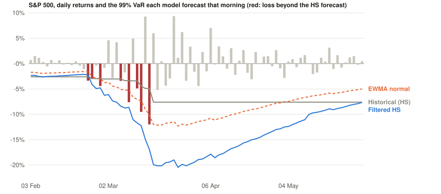

# Does a 95% VaR hold up? Three models on seven markets, 2008 to 2026

*Research note. Reproduce with `uv run python research/var_backtest.py`; raw results in
[var-backtest-results.csv](var-backtest-results.csv). Data to 24 November 2026.*

## Summary

Historical simulation, the VaR this project's report shows and the one most often met in
practice, gets the **number** of bad days right but not their **timing**. On all seven series
tested, its breaches cluster: the Christoffersen test rejects independence for every one at
95%. In March 2020 the S&P 500 broke its 99% historical VaR 8 times in 29 trading days, against
fewer than 1 expected.

An EWMA volatility with normal tails reacts in days and removes most of the clustering, but the
normal tails are too thin: at 99% it is breached about twice as often as promised, on every
series.

Filtered historical simulation, which combines the two, matches historical simulation on
coverage at 95% (all seven series), passes both tests on more series than either alternative,
and is the only model that never spends a rolling year in the Basel red zone at 99%. Its cost
is a much larger VaR right after a shock.

## Question and design

A one-day VaR at level $\alpha$ promises that the loss will exceed it on a fraction $1-\alpha$
of days, and that those days arrive independently: a breach today should not make one tomorrow
more likely. A model can keep the first promise and break the second. Its average is then
right, but it fails exactly when it matters.

| | |
|---|---|
| Series | Ibovespa, S&P 500, Euro Stoxx 50, FTSE 100, SMI, MSCI ACWI (iShares ETF), Bitcoin |
| Data | Daily closes in local currency (Yahoo Finance), each market's own trading days |
| Period tested | July 2008 to November 2026: 4,171 to 4,642 days per series |
| Forecast | Each day's VaR uses only returns before that day; all models are tested on the same days |
| Levels | 95% and 99%, one day, 250-day estimation window |
| Tests | Kupiec (1995) coverage, Christoffersen (1998) independence, conditional coverage, Basel (1996) zone of every rolling 250-day year at 99% |

The three models (`src/quant/var_models.py`):

- **HS, historical simulation.** The empirical 5% (or 1%) quantile of the last 250 returns.
- **EWMA normal (RiskMetrics, 1996).** $\sigma_t^2 = \lambda\sigma_{t-1}^2 + (1-\lambda)r_{t-1}^2$
  with $\lambda = 0.94$, and $\text{VaR}_t = -z_{1-\alpha}\,\sigma_t$.
- **FHS, filtered historical simulation (Hull and White, 1998; Barone-Adesi et al., 1999).**
  Divide each past return by its own day's EWMA volatility, take the empirical quantile of these
  standardised returns over 250 days, and rescale it by today's volatility.

## Results

Number of the seven series that pass each test at the 5% significance level:

| Level | Model | Mean breach rate | Coverage (Kupiec) | Independence (Christoffersen) | Both | Rolling years in Basel red zone |
|---|---|---|---|---|---|---|
| 95% | HS | 5.25% | **7** / 7 | **0** / 7 | 1 / 7 | |
| 95% | EWMA | 5.54% | 3 / 7 | 4 / 7 | 1 / 7 | |
| 95% | FHS | 5.20% | **7** / 7 | 3 / 7 | 3 / 7 | |
| 99% | HS | 1.33% | 3 / 7 | 1 / 7 | 1 / 7 | 2.4% |
| 99% | EWMA | 2.15% | **0** / 7 | 5 / 7 | 0 / 7 | 4.9% |
| 99% | FHS | 1.26% | 4 / 7 | 4 / 7 | 4 / 7 | **0%** |

**1. Historical simulation is right on average and wrong in crises.** At 95% its breach rate
is between 5.1% and 5.6% on every series and Kupiec never rejects it. But the independence test
rejects it on all seven. The figure shows why: from February to March 2020 the HS forecast stays
almost flat while losses pile up, because a 250-day window needs several extreme days before its
1% quantile moves. It breached 8 times between 20 February and 31 March 2020 on the S&P 500,
and 10 times in the last four months of 2008.

**2. EWMA fixes the timing but not the tails.** Its volatility reacts within days, so its
breaches are mostly independent (5 of 7 series at 99%). But it assumes normal returns, and daily
returns have fatter tails: at 99% it is breached 1.6% to 2.4% of the time, and Kupiec rejects it
on every series. A bank using it would have spent 4.9% of all rolling years in the red zone.

**3. FHS takes the timing from EWMA and the tails from the data.** It passes coverage at 95% on
all seven series, as HS does, passes both tests on 4 of 7 at 99% (HS 1, EWMA 0), and is the
only model with no red year at 99%. In the Covid crash it was breached once in 29 days.

**4. Nothing passes everywhere.** The FTSE 100 and the SMI reject independence for every model
at 95%, and Bitcoin rejects it for all three as well. Volatility clustering there outlasts what
a single EWMA with $\lambda = 0.94$ captures; a GARCH model with estimated parameters would be
the next test.

**The price of FHS.** It reacts hard. On the S&P 500 its average 99% VaR from April to June 2020
was 10.9%, against 7.6% for HS and 6.8% for EWMA. Right after a shock it asks for the most
capital, which is when capital costs most.

## Caveats

- The seven series are correlated, so the counts are not seven independent experiments. The
  2008 and 2020 crises hit them all at once.
- With about 4,500 days a test has good power. Rejecting at 5% on a long sample is a statement
  about the size of the effect as well as its existence.
- Index levels in local currency, so this is market risk alone. In the report, the portfolio in
  euro adds currency risk.
- One window (250 days) and one decay ($\lambda = 0.94$), both the industry defaults, chosen
  before looking at the results. They were not tuned.

## What changes in the project

The report keeps the historical VaR as its headline figure, because it is the standard and its
coverage holds. The backtest it already runs exposes the clustering for each portfolio
(Christoffersen verdict). The roadmap adds FHS beside it as the conditional figure for today,
with the same backtest, so the reader sees both "right on average" and "right now".

## References

- Barone-Adesi, G., Giannopoulos, K., Vosper, L. (1999). VaR without correlations for portfolios
  of derivative securities. *Journal of Futures Markets*, 19(5), 583–602.
- Basel Committee on Banking Supervision (1996). *Supervisory framework for the use of
  "backtesting" in conjunction with the internal models approach to market risk capital
  requirements.*
- Christoffersen, P. (1998). Evaluating interval forecasts. *International Economic Review*,
  39(4), 841–862.
- Hull, J., White, A. (1998). Incorporating volatility updating into the historical simulation
  method for value-at-risk. *Journal of Risk*, 1(1), 5–19.
- J.P. Morgan/Reuters (1996). *RiskMetrics: Technical Document*, 4th ed.
- Kupiec, P. (1995). Techniques for verifying the accuracy of risk measurement models.
  *Journal of Derivatives*, 3(2), 73–84.
